<h1>
   Supervisor with "NSX + DTGW/VNA"
</h1>

<div class="grid" markdown style="grid-template-columns: 60% 40%">

<div markdown>

This section describes the procedures for **deploying a Supervisor Namespace utilizing an "NSX + DTGW/VNA" architecture** inside a vSphere environment.

* **Namespace**
    * [**Deployment**](#namespacedeployment)
    * [Access via CLI](2d2-access-namespace.md)

</div>

<div markdown>
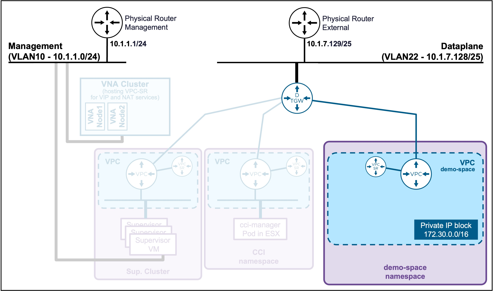{ width="100%" style="max-width: 250px;" }
</div>
</div>

---

## Namespace Deployment {: #namespacedeployment }

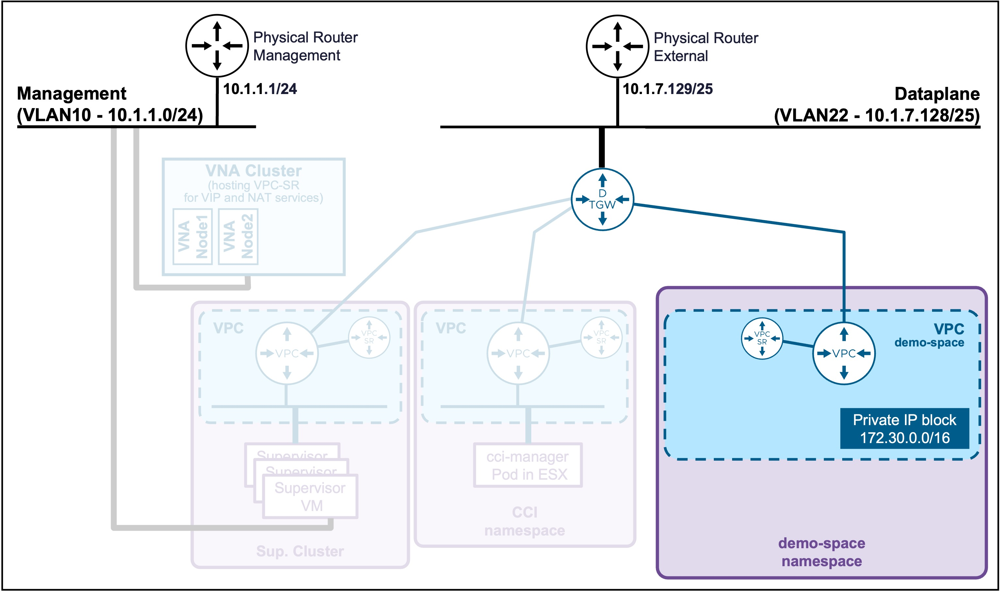{ width="80%" style="display: block; margin: 0 auto; max-width: 900px;" }


### Create Namespace
Navigate to **vCenter** > **Supervisor Management** > **Namespaces**, and click **NEW NAMESPACE**.
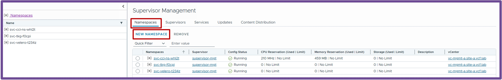{ width="95%" style="display: block; margin: 0 auto; max-width: 900px;" }

1. **Location**  
   Select the **Supervisor**, and click **Next**.  
    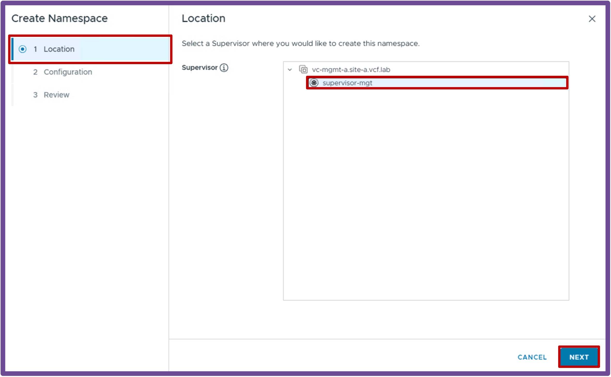{ width="95%" style="display: block; margin: 0 auto; max-width: 900px;" }  

2. **Configuration**  
   Give a name to the **Namespace**, and click **Next**.  
       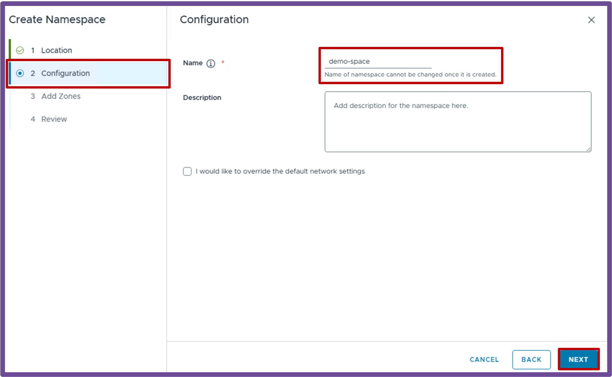{ width="95%" style="display: block; margin: 0 auto; max-width: 900px;" }  

    ??? info "Special Use Case: Override Network Settings"
        Multiple use cases are available:

        ??? info "Use Case1: Deploy that namespace with an existing VPC" 
            The typical use case is to have a namespace exiting via another External Connection than the one Supervisor uses.
                
            Select **Consume an existing VPC**, select the **Project / VPC**, **Default Subnet Size** (number power of 2) for future subnets, and click **Next**.
                

        ??? info "Use Case2: Deploy that namespace with a new VPC with different Default Subnet Size and Private VPC CIDRs settings" 
            
            Configure a **Default Subnet Size** (number power of 2) for future subnets, a **Private (VPC) CIDRs**, and click **Next**.
                

        ??? info "Use Case3: Provide Access to other VPC Subnets to this new namespace" 
            
            Add the external VPC Subnet you want to be shared with that namespace.  
                
            For this subnet to be used by default for future VMs and/or pods, that subnet must be on the VPC used by that namespace (see above Use Case1).
                

        ??? info "Use Case4: Enable NSX LB for future VKS deployments when using non default network settings (non needed if using AVI LB)"
            Future VKS deployments will need an Load Balancing (LB) service.  
            The LB service canbe offered by NSX or Avi.  
            When a namespace is deployed with the default network settings, NSX LB is automatically enabled (unless AVI LB is available in the Supervisor).  
            However, when a namespace is deploy with non-default network settings, then NSX LB must be manually enabled (unless you use AVI LB).  
            
            NSX LB can be enabled is a non-default namespace VPC currently only via NSX-API.  
            ```text
            PUT https://[NSX-Mgr]/policy/api/v1/orgs/default/projects/[project-name]/vpcs/[vpc-name]/vpc-lbs/lb-1  
            {
                "resource_type": "LBService",
                "display_name": "lb-1",
                "enabled": true,
                "size": "SMALL"
            }
            ```  

            ??? abstract "Output example"
                <pre><code>curl -k -i -X PUT \
                -H "Content-Type: application/json" \
                -u 'admin:VMware123!VMware123!' \
                "https://nsx-wld01-a.site-a.vcf.lab/policy/api/v1/orgs/default/projects/default/vpcs/vpc-wld01-a/vpc-lbs/lb-1" \
                -d '{
                    "resource_type": "LBService",
                    "display_name": "lb-1",
                    "enabled": true,
                    "size": "SMALL"
                }'
                </code></pre>
            And then, you can see NSX LB is enabled in the VPC:  
                


3. **Add Zones**  
   Select the **Workload Zone** (one or more vCenter Clusters), and click **Next**.  
    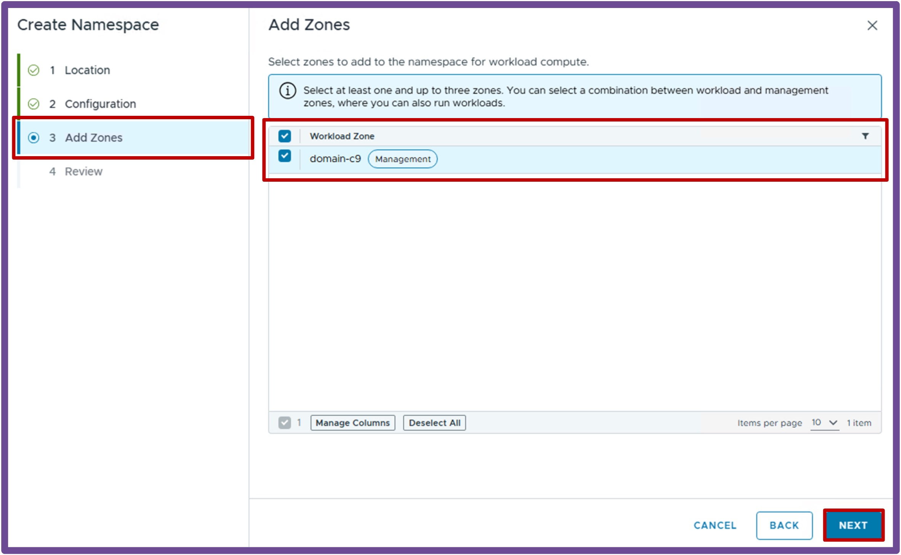{ width="95%" style="display: block; margin: 0 auto; max-width: 900px;" }  

4. **Review**  
   Review the Namespace settings, and click **Finish**.  
    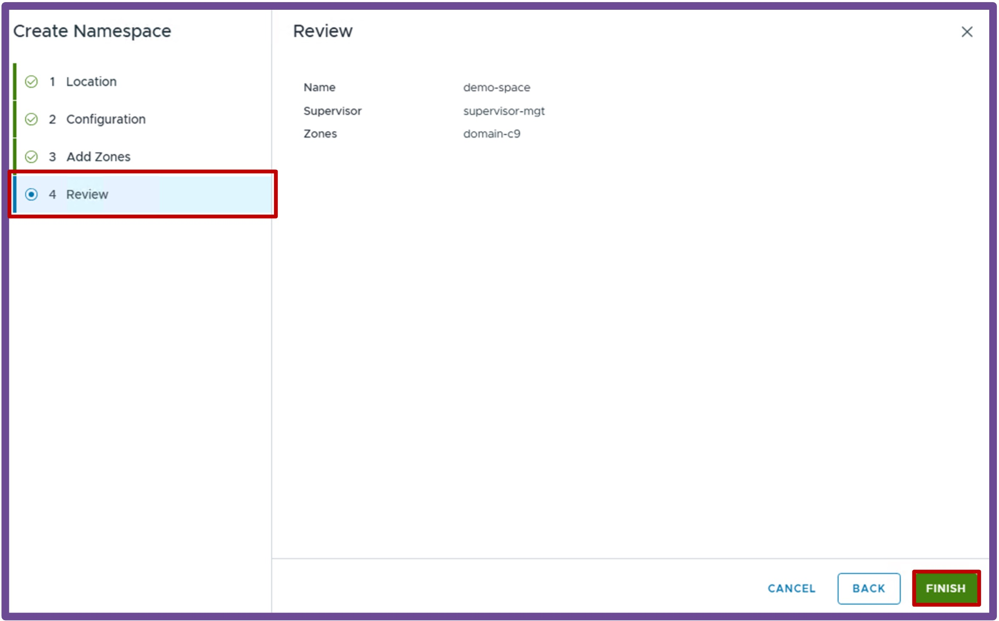{ width="95%" style="display: block; margin: 0 auto; max-width: 900px;" }  


---

### Finish Namespace Creation for future Applications

#### **Create a Content Library for future VMs**  
If you plan to deploy VMs, create a Content Library with VM images.  
Navigate to **vCenter** > **Content Libraries** > and click **Create**.  
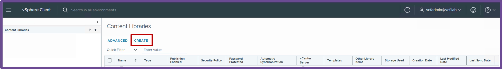{ width="95%" style="display: block; margin: 0 auto; max-width: 900px;" }  

1. **Name and Location** Give it a **Name** and select the **vCenter** hosting that Content Library, and click **Next**.  
    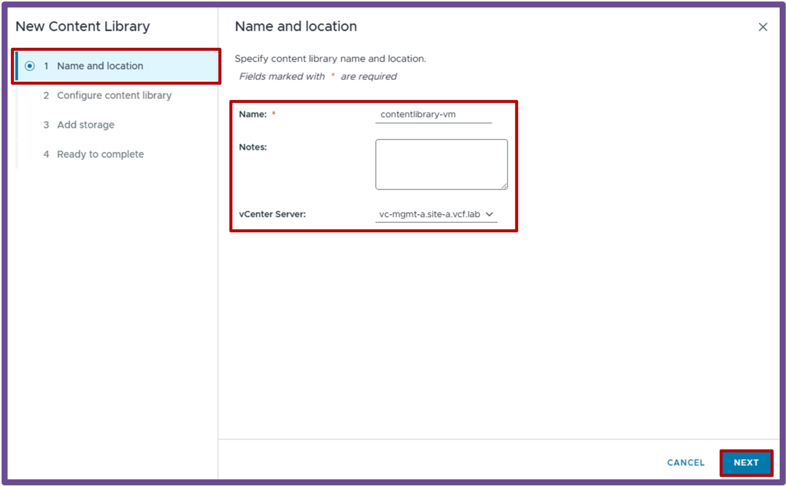{ width="85%" style="display: block; margin: 0 auto; max-width: 900px;" }  
    
1. **Configure Content Library** Choose between **Local content library** (you upload VM images) and **Subscribed content library** (vCenter downloads VM images from a repository), and click **Next**.  
    *I'm using here Local content library.* 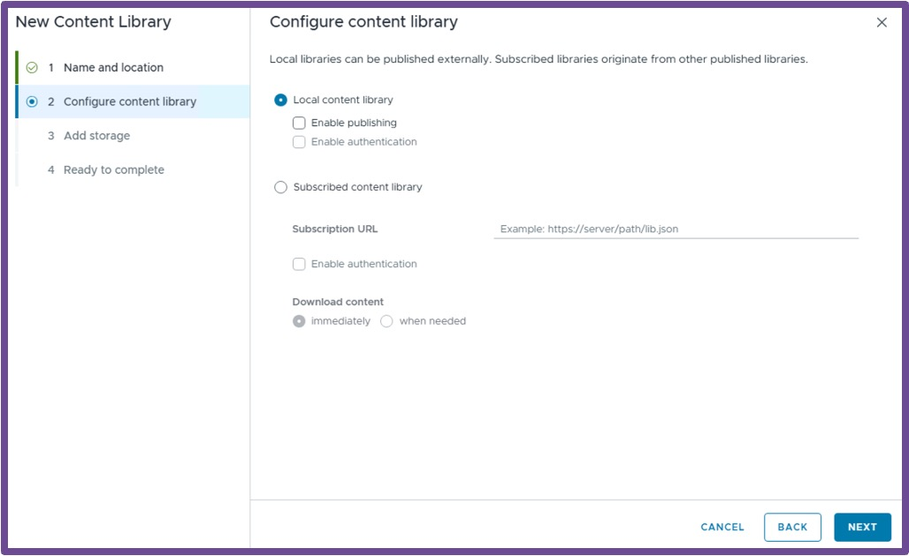{ width="85%" style="display: block; margin: 0 auto; max-width: 900px;" }  

1. **Apply Security Policy** Apply **security policy** if you choose to, and click **Next**.  
    *I'm using here no security policy.* 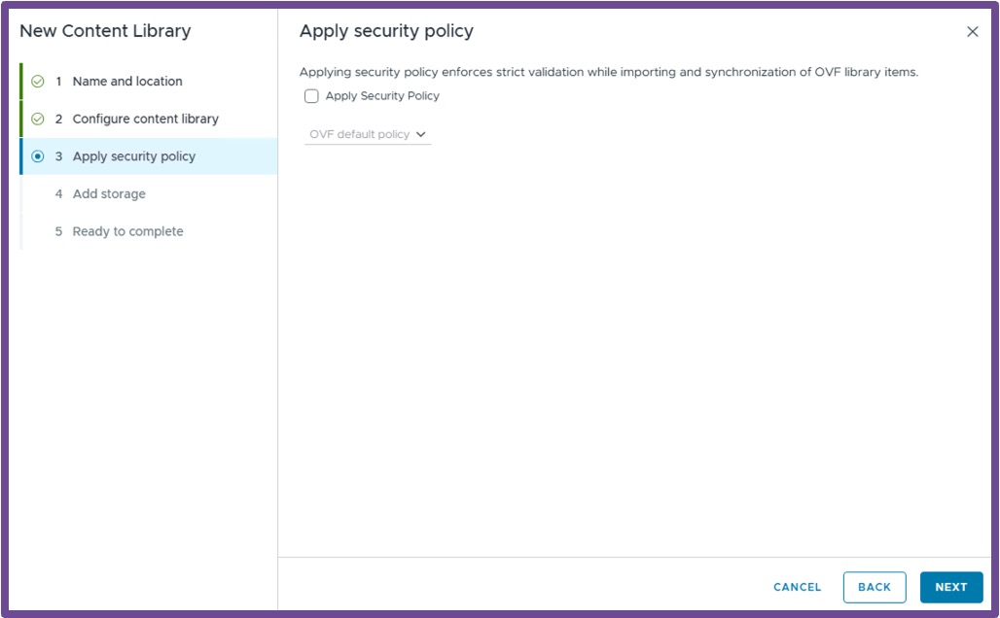{ width="85%" style="display: block; margin: 0 auto; max-width: 900px;" }  

1. **Add Storage** Select a **storage** to host the content library images, and click **Next**.  
    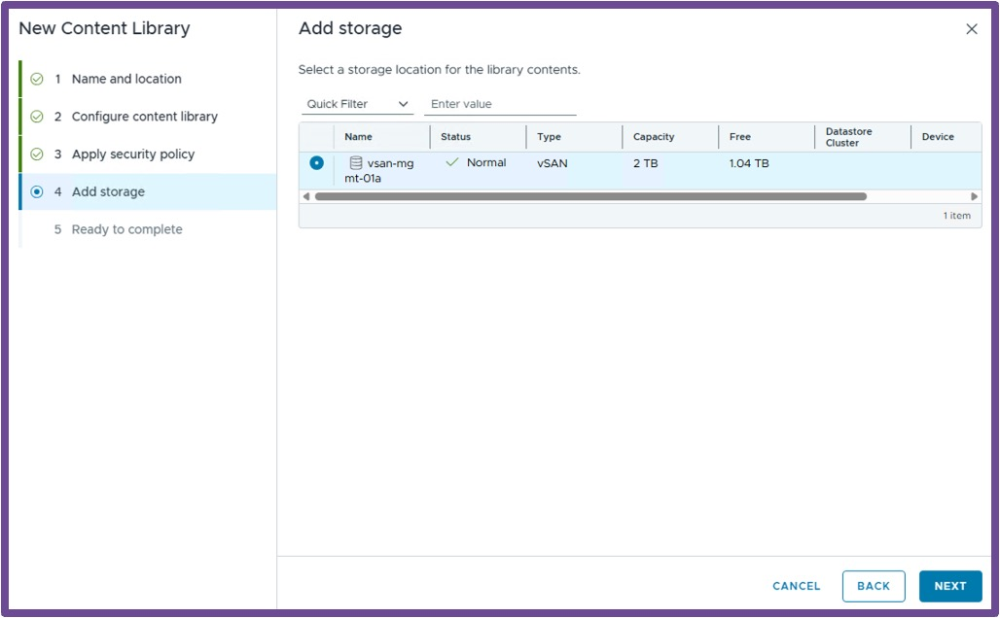{ width="85%" style="display: block; margin: 0 auto; max-width: 900px;" }  

1. **Ready to complete** Review the content library, and click **Finish**.  
    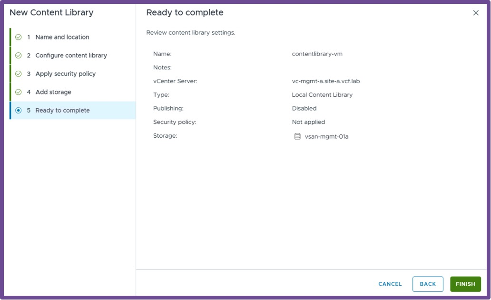{ width="85%" style="display: block; margin: 0 auto; max-width: 900px;" }  

1. **Import VM Image** In the Content Library created, import a VM Image, click on **Import Item**.  
    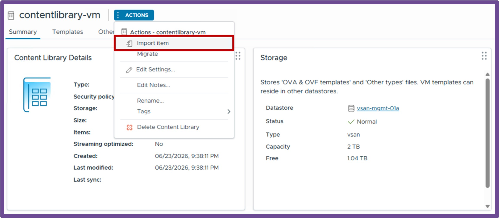{ width="85%" style="display: block; margin: 0 auto; max-width: 900px;" }  

1. **Choose VM Image** Choose a **Source file** via URL or Local file, and click **Import**.  
    *I'm using here the URL https://cloud-images.ubuntu.com/noble/current/noble-server-cloudimg-amd64.ova to download Ubuntu 24.04.* 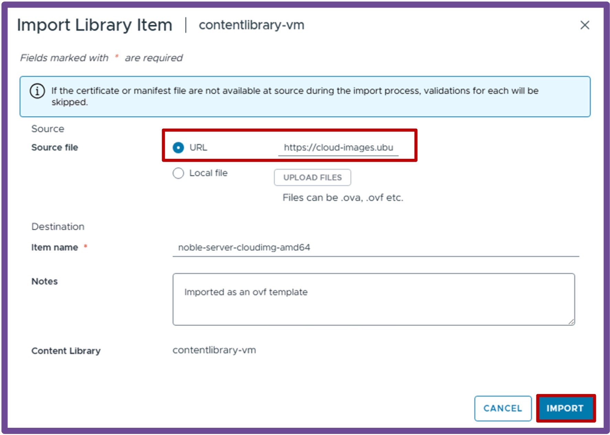{ width="85%" style="display: block; margin: 0 auto; max-width: 900px;" }  

#### **Associate the Content Library to the Namespace**  
Navigate to **vCenter** > **Supervisor Management** > **Supervisors**, select **[your supervisor]**, navigate to **Namespaces**, and select **[your namespace]**, and click on **VM Service - Add Content Library**.
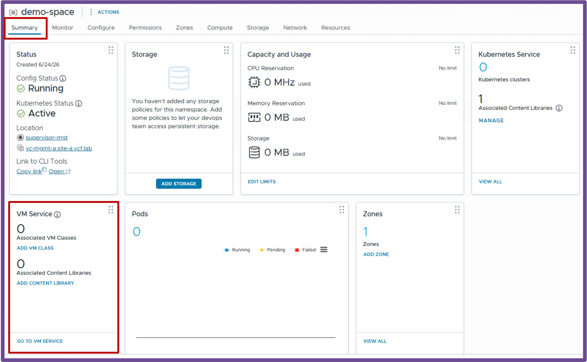{ width="95%" style="display: block; margin: 0 auto; max-width: 900px;" }  

1. **Add Content Library** Select **Content Library with VM images**, and click **OK**.  
    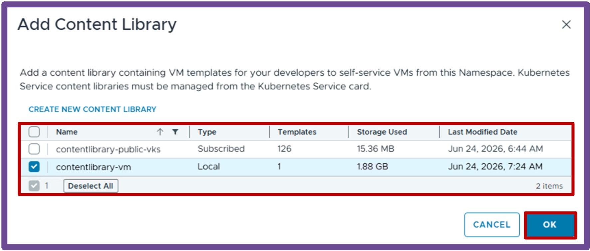{ width="85%" style="display: block; margin: 0 auto; max-width: 900px;" }  

#### **Associate Storage Policy to the Namespace**
Navigate to **vCenter** > **Supervisor Management** > **Supervisors**, select **[your supervisor]**, navigate to **Namespaces**, and select **[your namespace]**, and click on **Storage - Add Storage**.
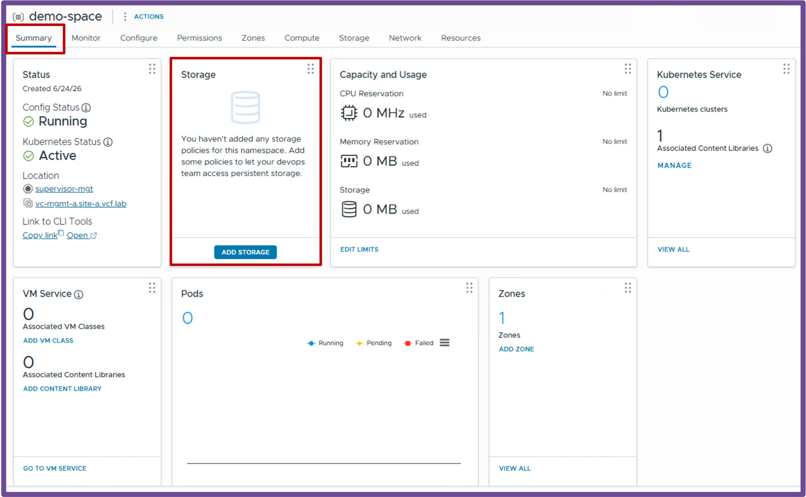{ width="95%" style="display: block; margin: 0 auto; max-width: 900px;" }  

1. **Add Storage Policy** Select **Storage Policy**, and click **OK**.  
    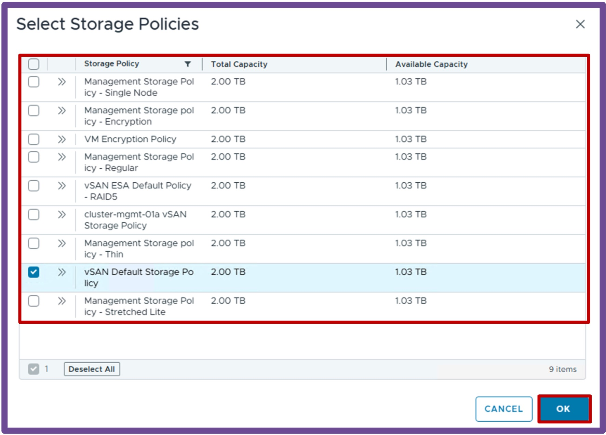{ width="85%" style="display: block; margin: 0 auto; max-width: 900px;" }  


#### **Associate VM Class to the Namespace**  
Navigate to **vCenter** > **Supervisor Management** > **Supervisors**, select **[your supervisor]**, navigate to **Namespaces**, and select **[your namespace]**, and click on **VM Service - Add VM Class**.
{ width="95%" style="display: block; margin: 0 auto; max-width: 900px;" }  

1. **Add VM Classes** Select **VM Classes**, and click **OK**.  
*I selected here all VM Classes type "small" and "medium".*
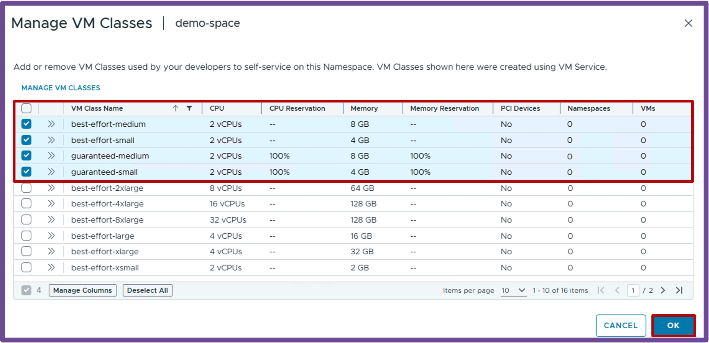{ width="85%" style="display: block; margin: 0 auto; max-width: 900px;" }  


---

### Validate Deployment

#### **Validate Namespace Status** 
Once the wizard completes, verify the deployment was successful by navigating to **vCenter** > **Supervisor Management** > **Supervisors**, select **[your supervisor]**, and navigate to **Namespaces**.

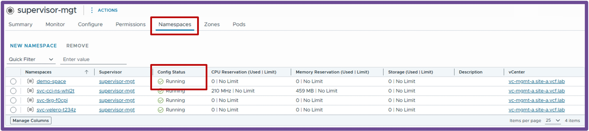{ width="85%" style="display: block; margin: 0 auto; max-width: 900px;" }

#### **Validate Namespace Storage and Content Library** 
Verify the Namespace has at least a **Content Library**, **VM Classes**, and **Storage** by navigating to **vCenter** > **Supervisor Management** > **Supervisors**, select **[your supervisor]**, navigate to **Namespaces**, and select **[your namespace]**.
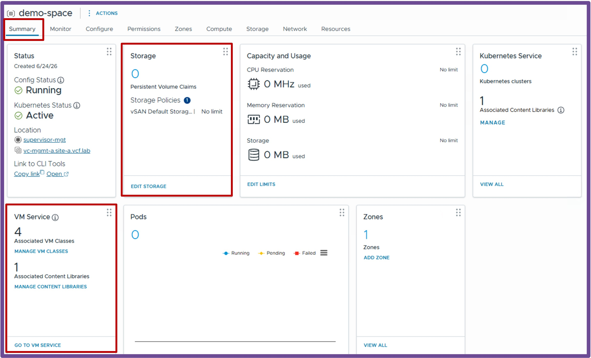{ width="85%" style="display: block; margin: 0 auto; max-width: 900px;" }


